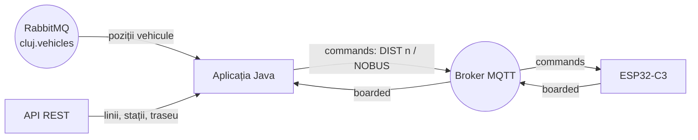

# Tema 04 – Tracker personal de autobuz pe ESP32-C3: soluție

**Tehnologii:** ESP32-C3 Super Mini, Arduino IDE, FreeRTOS, MQTT, RabbitMQ, Java 17
**Student:** `ananechita15` · **Placă:** `esp32-1e62c4` · **Linia:** 21, sensul spre Dacia Service Sosire, **stația:** Fagului

## Ce face soluția

Aplicația Java urmărește autobuzele liniei 21 și calculează cât de departe, pe traseu, este cel mai apropiat autobuz care încă nu a ajuns la stația Fagului. Distanța ajunge la placa ESP32 prin MQTT, iar placa o arată prin LED. Când utilizatorul urcă în autobuz, apasă butonul **BOOT**; placa trimite un mesaj înapoi, iar aplicația Java se oprește.

## Arhitectura



## Aplicația Java

Folderul `aplicatie-java/` (proiect Maven).

| Clasă | Rol |
|---|---|
| `TrackerApp` | alegerea liniei, sensului și stației; la fiecare 5 s calculează și trimite distanța |
| `ApiClient` | cere liniile, stațiile și traseul din API REST, cu headerul `X-API-Key` |
| `VehicleListener` | citește pozițiile din RabbitMQ, pe o coadă temporară proprie legată la exchange-ul `cluj.vehicles` |
| `NearestBus` | alege cel mai apropiat autobuz care vine spre stație |
| `Geo` | distanța între două puncte (haversine) |
| `BoardLink` | clientul MQTT: trimite `DIST` / `NOBUS`, primește `BOARDED` |
| `Config`, `Model` | constante și tipuri de date |

**Cum se calculează distanța.** Vehiculul și stația sunt proiectate pe traseul liniei, iar distanța se măsoară de-a lungul traseului. Se ignoră vehiculele care au trecut deja de stație sau care sunt la mai mult de 150 m de traseu.

**Date imperfecte.** Vehiculele care nu au mai trimis nimic de peste 120 s sunt scoase. Câmpurile lipsă au valori implicite. Un mesaj stricat este ignorat.

## Mesaje MQTT

Broker: `tcp://control.aut.utcluj.ro:11188`, QoS 1. Toate topicurile încep cu `ssatr/ananechita15/devices/esp32-1e62c4/`.

| Topic | Sens | Format |
|---|---|---|
| `commands` | Java → placă | `DIST <metri>` sau `NOBUS` |
| `boarded` | placă → Java | `deviceId;timestamp;BOARDED` |

## Aplicația de pe placă

Folderul `esp32_tracker/`.

| Task | Tip | Prioritate | Ce face |
|---|---|---|---|
| `led_task` | periodic, 100 ms | 5 | clipește LED-ul după distanță (`xTaskDelayUntil`) |
| `button_task` | sporadic | 4 | primește apăsările din ISR; acceptă una la cel puțin 1000 ms, restul sunt respinse |
| `command_task` | aperiodic | 3 | execută `DIST` / `NOBUS`; o comandă necunoscută dă ERROR, dar task-ul continuă |
| `button_isr` | întrerupere | – | doar pune evenimentul în coadă |

Prioritățile urmează Rate Monotonic: perioada cea mai scurtă are prioritatea cea mai mare. Distanța este într-o stare comună protejată de un mutex, ținut foarte scurt. Mutexul și cozile se creează înainte de `mqtt_start()`.

### LED și buton

| Situație | LED (GPIO 8) |
|---|---|
| sub 300 m | clipire rapidă (100/100 ms) |
| sub 1000 m | clipire medie (300 ms) |
| sub 2500 m | clipire lentă (800 ms) |
| peste 2500 m | foarte lentă (2 s) |
| fără date, `NOBUS` sau 30 s fără mesaj | sclipire scurtă la 3 s |
| BOOT apăsat (`BOARDED`) | aprins continuu 3 s |

Butonul BOOT este pe GPIO 9.

## Cum se rulează

1. În `esp32_tracker/config.h` pune rețeaua Wi-Fi (2.4 GHz); în repo este `iot-demo`. Încarcă schița din Arduino IDE (ESP32C3 Dev Module, USB CDC On Boot: Enabled).
2. În PowerShell, în `aplicatie-java`:

```powershell
$env:CTP_KEY = "<cheia API>"
$env:RABBIT_USER = "<utilizator>"
$env:RABBIT_PASS = "<parola>"
mvn -q compile exec:java
```

3. Alege linia, sensul și stația. Apasă BOOT pe placă pentru a confirma.

**Cheia API, parola RabbitMQ și parola Wi-Fi nu sunt în repo.**

## Limite

- Datele serverului se actualizează cam la 20 de secunde.
- Dacă traseul nu are puncte (shape), se folosește distanța în linie dreaptă.
